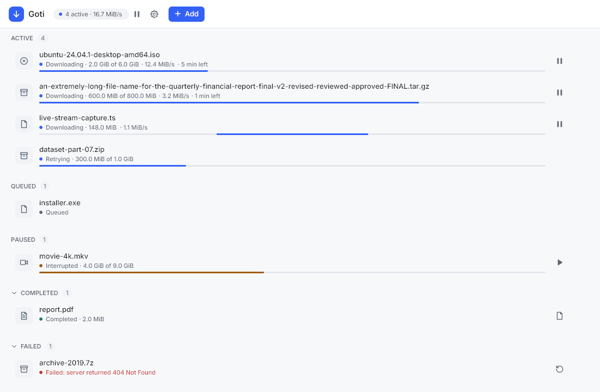
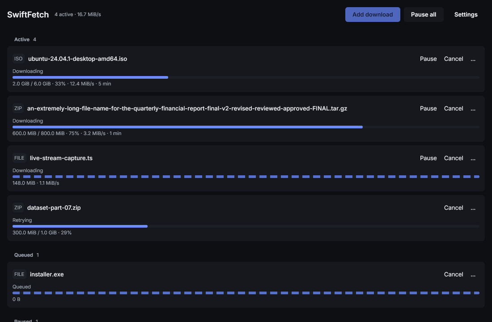
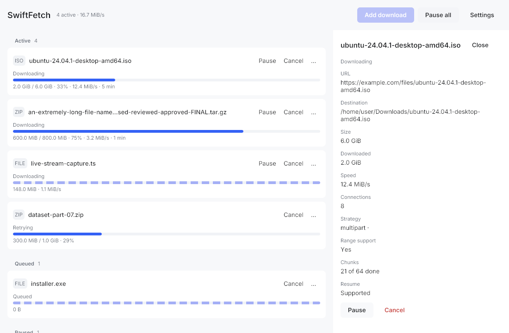
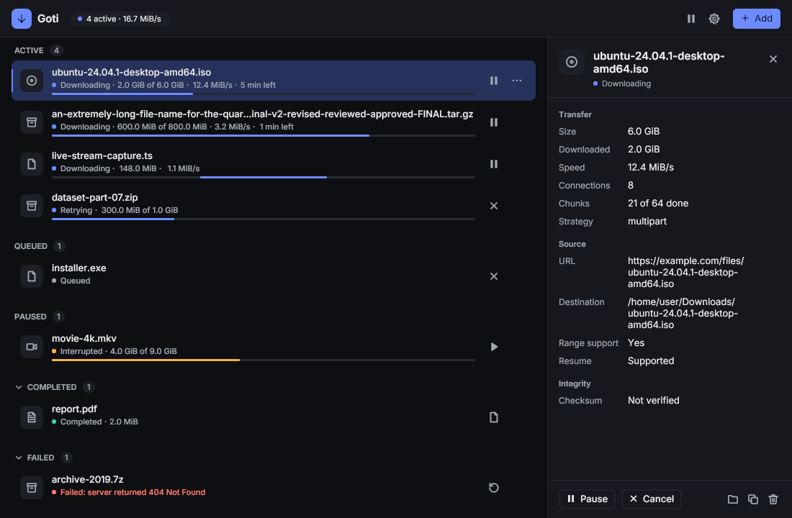
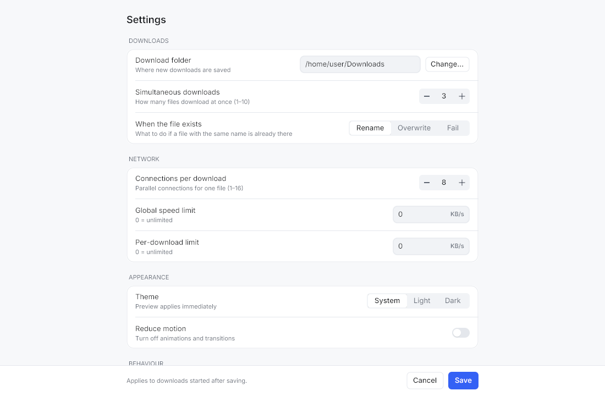
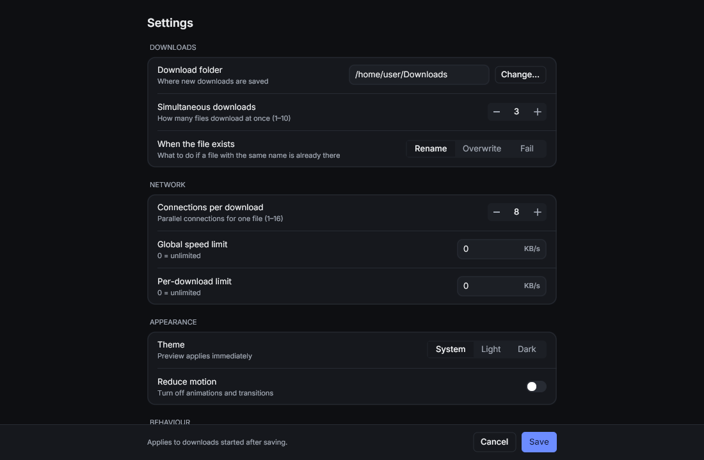
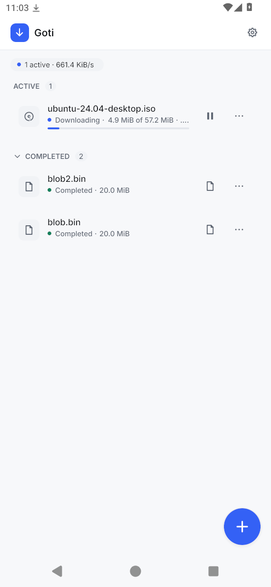
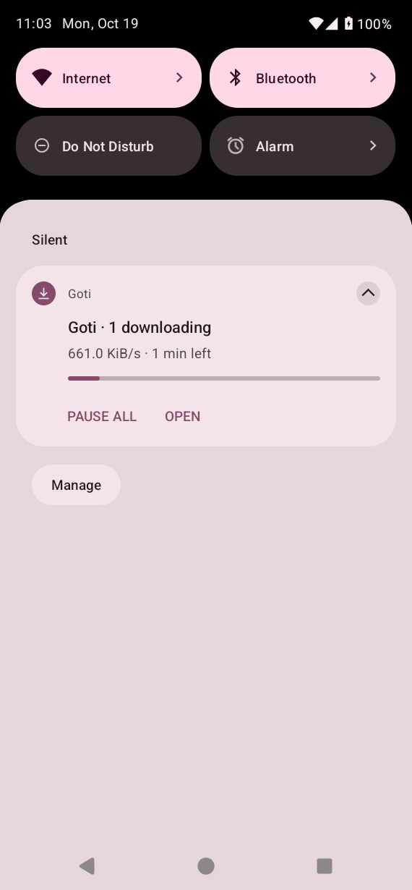

# Goti (গতি)

*Fast by design. Reliable by nature.*

Goti is a headless download engine written in Go, plus a small CLI
(`goti-cli`). It checks what a server actually supports before it picks a
strategy. Downloads are resumable, verified, and crash-safe. It is built to keep
memory use small: about 20 MiB RSS idle, and at most 40 MiB during an
8-connection download.

The engine and CLI contain no GUI code and no cgo; the GUI
lives in `cmd/goti` (described below, needs cgo). Engine builds use `CGO_ENABLED=0`.

## Install

Download the file for your platform from the
[Releases](https://github.com/raptordnj/goti/releases) page. Each release has a
`SHA256SUMS` file; check a download with `sha256sum -c SHA256SUMS --ignore-missing`.

| Platform | File | Install |
|---|---|---|
| Omarchy, Arch, Manjaro | `goti_<ver>_linux_<arch>.pkg.tar.zst` | `sudo pacman -U goti_*_linux_amd64.pkg.tar.zst` |
| Debian 12+, Ubuntu 22.04+ | `goti_<ver>_linux_<arch>.deb` | `sudo apt install ./goti_*.deb` |
| Fedora, openSUSE | `goti_<ver>_linux_<arch>.rpm` | `sudo dnf install ./goti_*.rpm` |
| Other Linux (glibc 2.35+) | `goti_<ver>_linux_<arch>.tar.gz` | extract, then `./install-linux.sh` (installs for the current user) |
| Windows 10/11 | `Goti_<ver>_windows_amd64_setup.exe` | run the installer (a portable `.zip` is also provided) |
| macOS 11+ | `Goti_<ver>_macos_<arch>.dmg` | open the dmg, drag Goti to Applications |
| Android 8.0+ | `Goti_<ver>_android_universal.apk` | open the APK on the phone and allow installs from your browser or file manager |

Linux packages are built for `amd64` and `arm64`; macOS for `arm64` (Apple
silicon) and `amd64` (Intel). Each package contains the GUI (`goti`) and the
CLI (`goti-cli`). On macOS the CLI is a separate `goti-cli_<ver>_macos_<arch>.tar.gz`.

The builds are not code-signed by a paid certificate:

- Windows: SmartScreen may say "Windows protected your PC". Click
  **More info**, then **Run anyway**.
- Android: the APK is signed with the project's own release key (not a Play Store
  build). Updates install over earlier versions because the key stays the same.
- macOS: the app is ad-hoc signed but not notarized. On first launch,
  right-click Goti in Applications and choose **Open**, then **Open** again.

## Build from source

Requires Go 1.27.

```sh
make build                      # bin/goti-cli
go install github.com/raptordnj/goti/cmd/goti-cli@latest
make cross                      # linux/windows/darwin x amd64/arm64 into bin/
```

## GUI (goti)

`cmd/goti` is a desktop GUI built with [Gio](https://gioui.org) on top of
the engine, with a small download queue and a system tray. Unlike the engine and
the CLI, it needs cgo and platform graphics headers.

### Screenshots

| Light | Dark |
|---|---|
|  |  |
|  |  |
|  |  |

The images are rendered headlessly from fixtures (`make screenshots`); the
full set, including narrow layouts, dialogs, the row menu and toasts, is in
[`docs/screenshots/`](docs/screenshots/).

On Android (captured on a device):

| Main screen | Notification |
|---|---|
|  |  |

### Build dependencies

- Linux (Arch): `pacman -S wayland libxkbcommon libxcursor libxfixes vulkan-headers mesa`
- Linux (Debian/Ubuntu): `apt install gcc pkg-config libwayland-dev libx11-dev libxkbcommon-x11-dev libgles2-mesa-dev libegl1-mesa-dev libxcursor-dev libxfixes-dev libvulkan-dev`
- Windows: a C toolchain is not required for Gio itself; a working GPU driver (Direct3D 11) is enough.
- macOS: Xcode command line tools.

### Build and run

```sh
go build ./cmd/goti      # or: make gui  (writes bin/goti)
./goti --data-dir /path/to/data
```

The data directory defaults to the OS location listed under Configuration
defaults. Override it with `--data-dir` or `GOTI_DATA_DIR`.

The window opens at 960×640 (minimum 640×420). From 1000 px wide, details
show as a side pane; narrower windows use a bottom sheet.

### Mouse

- Click a row to select it and show its details; double-click a completed
  download to open the file.
- Each row has one primary action (pause, resume, retry, open or cancel);
  the `⋯` button on a hovered or selected row opens the rest (show in
  folder, copy link or path, restart, cancel, remove).
- Completed and Failed sections collapse from their headers.
- Settings > Appearance > Reduce motion turns off all animations.

### Keyboard shortcuts

| Key | Action |
|---|---|
| Tab / Shift+Tab | Move focus (visible focus ring) |
| Ctrl+N | Add download |
| Ctrl+V (outside text fields) | Add download prefilled from the clipboard |
| Up / Down | Move selection |
| Enter | Open details |
| Space | Pause / resume selected |
| Delete | Remove selected (asks for confirmation) |
| Esc | Close dialog / details |
| Ctrl+, | Settings |
| Ctrl+Q | Quit |

### Tray

- KDE Plasma: works out of the box.
- GNOME: requires the AppIndicator/KStatusNotifierItem extension. Without a
  StatusNotifier host the tray is unavailable and closing the window quits.
- macOS: the tray is disabled for now (needs main-thread integration).
- Windows: implemented but not yet verified.

With the tray available and "Close to tray" enabled, closing the window keeps
downloads running; use the tray menu to show the window or quit.

### Single instance

Only one GUI may use a data directory at a time (a `gui.lock` file in it). A
second launch on the same data directory exits with an error; it does not
activate the first window.

### Manual checklist

- Tray on KDE and on GNOME with AppIndicator: show, pause/resume all, quit.
- Folder picker in the Add dialog and Settings.
- Open file and open folder from a completed download.
- Keyboard navigation: Tab order, focus ring, all shortcuts above.

### Known limitations (GUI)

Deferred to a later queue and polish phase: priorities, manual reorder, history
search/filter, duplicate detection, drag-and-drop URLs, multi-select and bulk
actions, rich animation, second-launch activation (IPC), packaging and signing.

## CLI usage

```
goti-cli get URL [-o DIR] [--conns auto|N] [--limit RATE] [--sha256 HEX] [--on-exists rename|overwrite|fail] [--conservative]
goti-cli explain URL
goti-cli list
goti-cli resume ID [--restart-if-changed]
goti-cli rm ID [--delete-partial]
```

Examples:

```sh
goti-cli get https://example.com/big.iso -o ~/Downloads
goti-cli get https://example.com/big.iso --limit 2M --sha256 <64 hex chars>
goti-cli get https://example.com/big.iso --conns 4      # warns: forcing connections can hurt throughput
goti-cli explain https://example.com/big.iso            # inspect only; downloads probe bytes only
goti-cli list                                           # state, progress, redacted URL
goti-cli resume 3f2a...                                 # recover + revalidate, then continue
goti-cli rm 3f2a... --delete-partial                    # never deletes completed files
```

- The progress line is redrawn at most 4 times a second. It shows the name,
  percent, downloaded/total, speed, ETA, connections and strategy.
- **Ctrl-C:** the first press pauses gracefully. Workers stop, a final
  checkpoint is written, and the state becomes `paused`. A second press within
  2 s exits immediately; the next run recovers the state.
- **Exit codes:** 0 success, 1 failed, 2 usage/config error, 3 paused/interrupted.
- `GOTI_DATA_DIR` overrides the data directory. The CLI caps the Go heap
  with `debug.SetMemoryLimit(32 MiB)` unless `GOMEMLIMIT` is set.

## How strategy selection works

Every download starts with an inspection, and every probe is bounded: 15 s
timeout, at most 10 redirects, 1 MiB of headers, and capped body reads.

1. The URL is validated: `http`/`https` only, a host is required, and the
   length is at most 8 KiB.
2. **Probe 1** is a `GET` with `Range: bytes=0-0` (HEAD is never trusted). The
   response shapes the decision:
   - `206` with a correct `Content-Range` and a 1-byte body: ranges are a
     candidate and the size is known.
   - `200`: the server ignored the range.
   - `416 bytes */0`: the resource is empty.
   - `401/403`: an auth error. `404/410`: a permanent error.
   - `429/503`: a transient error, retried with `Retry-After`.
3. **Probe 2** runs only when ranges are a candidate and the size is at least
   `MinMultipartSize`. It asks for 2 bytes at `floor(N/2)` with `If-Range`.
   Ranges count as *proven* only if the status, `Content-Range`, total, body
   length and validators all match.
4. Validators rank as follows: strong ETag, then `Last-Modified`, then none.
   Weak ETags count as none.
5. The inspection also detects signed or expiring URLs, resolves the filename
   (`Content-Disposition` first, then the URL path, then `download`, always
   sanitized), and applies heuristics for dynamic (streamed) content.

`strategy.Select` is a pure function. It applies these rules in order:

- **E: unsupported or restricted.** Auth, permanent and policy errors, or the
  retry budget ran out during inspection.
- **D: resume.** The stored validator, size and URL must match the fresh
  probe. On a mismatch the task gets `RemoteChanged` and pauses, and old bytes
  are never combined with new ones.
- **A: single stream.** Used when the size is unknown, ranges are unproven,
  the file is smaller than `MinMultipartSize`, there is no validator,
  `MaxConnections == 1`, or the resource is dynamic.
- **C: conservative multipart.** Ranges are proven, but probe RTT is over
  400 ms, a probe was retried or timed out, or `ConservativeMode` is set. It
  starts with 1 connection, allows at most 2, and uses chunks of at least 4 MiB.
- **B: adaptive multipart.** It starts with 2 connections and grows to
  `MaxConnections` (default 8, hard cap 16).

`--conns N` sets the initial and maximum connections to N, but ranges must
still be proven first. Example `explain` output against a server that ignores
`Range`:

```
URL:        http://127.0.0.1:18765/big.bin
Final URL:  http://127.0.0.1:18765/big.bin
Strategy:   single
Confidence: medium
Size:       50.0 MiB
Validator:  last-modified
Connections: initial 1, max 1
Reasons:
  - single stream: byte ranges not proven
  - an interrupted download restarts from zero
Anomalies:
  - server ignored Range (200)
Probes:
  - bytes 0-1: status 200, -1 bytes, 3ms
```

## Durability trade-offs

A checkpoint runs every `CheckpointInterval` (2 s) or `CheckpointBytes`
(16 MiB). Each one first `fsync`s the data, then writes the segment progress
and the serialized SHA-256 state in a single SQLite transaction. On recovery
Goti re-hashes every completed and in-progress range from disk, and it
reuses only the bytes that verify.

Trade-off: the checkpoint interval limits lost work to about interval ×
throughput. Recovery re-reads verified data from disk once, so the disk-read
cost is about the downloaded size. That is far cheaper than downloading again,
and it is the price of never reusing unverified bytes. `CheckpointInterval` can
be set from 0.5 to 30 s.

## Security defaults

- **Address policy** (`AllowDirectPrivate`): a loopback, private or link-local
  destination is allowed only when the URL you supplied already points there.
  A public URL that redirects or rebinds to a private address is refused. The
  check runs against the resolved IP of every connection.
- **Redirects:** at most 10. An `https → http` downgrade is refused.
  `Authorization` and userinfo are dropped on cross-host redirects.
- **Filenames:** names the server supplies are sanitized: separators, control
  characters, leading dots and Windows reserved names are handled, and names
  are capped at 200 bytes. The path is then checked to stay inside the
  destination directory.
- **Redaction:** one `transport.Redact` function is used for every log line,
  event, stored error and CLI output. It removes userinfo and signed or secret
  query values. This function is fuzz-tested.
- **TLS:** system roots are used and verification is always on. There is no
  option to turn it off.
- **No silent overwrite:** existing files are renamed to `name (1).ext` by
  default. A file is overwritten only with `--on-exists overwrite`.

## Configuration defaults

| Setting | Default | Valid range |
|---|---|---|
| MaxConnections (per download) | 8 | 1–16 |
| GlobalMaxConnections | 16 | 1–64 |
| InitialConnections | auto (2 for B, 1 for C) | 1–MaxConnections |
| AdaptiveConcurrency | true | — |
| MinMultipartSize | 8 MiB | ≥ 1 MiB |
| ChunkSizeMin / Max | 1 MiB / 64 MiB | min ≤ max |
| GlobalRateLimit / PerDownloadRateLimit | 0 (unlimited) | ≥ 0 bytes/s |
| RetryBaseDelay / Max / Factor | 500 ms / 60 s / 2 | — |
| MaxSegmentAttempts / TaskRetryBudget | 8 / 50 | ≥ 1 |
| StallTimeout | 30 s | 5–600 s |
| CheckpointInterval / CheckpointBytes | 2 s / 16 MiB | 0.5–30 s / ≥ 1 MiB |
| ProbeTimeout | 15 s | 1–120 s |
| OfflineWaitLimit | 24 h | 0 (forever) or ≥ 1 min |
| ExistingFilePolicy | rename | rename, overwrite, fail |
| RestartOnRemoteChange | false | — |
| ConservativeMode | false | — |
| NetworkPolicy | AllowDirectPrivate | — |
| AllowHTTPSDowngrade | false | — |
| ProgressHz | 4 | 1–30 |
| DownloadDir | OS downloads dir (`$XDG_DOWNLOAD_DIR` or `~/Downloads`) | existing dir |
| DataDir | `$XDG_DATA_HOME/goti` / `%LOCALAPPDATA%\Goti` / `~/Library/Application Support/Goti` | — |

## Upgrading from SwiftFetch

Goti was previously named SwiftFetch. On first start, both `goti` and `goti-cli`
rename the old data directory (`$XDG_DATA_HOME/swiftfetch`, `%LOCALAPPDATA%\SwiftFetch`,
`~/Library/Application Support/SwiftFetch`) to the new location. They never copy and delete, and the
database keeps its `swiftfetch.db` name (new installs use `goti.db`). If the rename fails,
or an old GUI, CLI or database user is still active, the old directory is used for that run and a warning is
logged. `SWIFTFETCH_DATA_DIR` is still honoured as a deprecated fallback for
`GOTI_DATA_DIR`.

## Known limitations

- Corruption that preserves length and headers is detectable only with a user-supplied expected checksum; per-segment hashes protect against *local* disk corruption and crash damage, not against a server sending wrong bytes.
- Unknown-size downloads cannot be resumed after interruption.
- Persisted URLs are plaintext (file-permission protected).
- `link`+`unlink` fallback finalization is not atomic against a concurrent creator on exotic filesystems; it still never overwrites.
- Windows and macOS correctness is verified by CI (sub-project 4); in this sub-project they are cross-compiled only.

Also known in this release:

- `Progress.ActiveConns` is currently always 0, so the CLI progress line does
  not show the live connection count.
- A pause requested while a task is `verifying` is ignored. Verification runs
  to completion.

## Development

```sh
make test     # go test ./...  (full suite: 5 GiB download, 20x crash test, harsh soak, memory bounds)
make race     # go test -race -short ./...
make lint     # golangci-lint run
make fuzz     # every Fuzz* target for 30 s
make bench    # loopback smoke benchmarks
make build    # CGO_ENABLED=0 CLI build
make cross    # six OS/arch targets
make screenshots  # re-render docs/screenshots (needs a headless GPU)
gofmt -l .  &&  go vet ./...
```

## Releases

Pushing a version tag builds every platform and publishes a GitHub Release
(`.github/workflows/release.yml`):

```sh
git tag vX.Y.Z && git push origin vX.Y.Z
```

GitHub Actions runs only on version tags: the tag push runs the checks (gofmt, vet, race tests),
builds every platform (Linux deb/rpm/Arch/tar.gz for amd64 and arm64, Windows NSIS installer and
zip, macOS dmg for Apple Silicon and Intel, a signed universal Android APK) and publishes them in one GitHub Release with
`SHA256SUMS`. A tag containing `-` (for example `v1.2.0-rc.1`) is published as a pre-release.

### Android builds

Needs the Android SDK (`ANDROID_HOME`), NDK 27, JDK 21 and `gogio`
(`go install gioui.org/cmd/gogio@v0.10.3`):

```sh
make apk-debug                               # android/app/build/outputs/apk/debug/app-debug.apk
scripts/package-android.sh 0.2.0 dist        # signed release APK
```

`package-android.sh` reads the signing key from `ANDROID_KEYSTORE_B64`,
`ANDROID_KEYSTORE_PASSWORD`, `ANDROID_KEY_ALIAS` and `ANDROID_KEY_PASSWORD`;
CI takes them from repository secrets of the same names.

#### Device smoke test

Run before tagging a release (CI does not run an emulator). It needs a
running emulator or VM on `adb` and a debug APK:

```sh
make apk-debug
scripts/android-smoke.sh android/app/build/outputs/apk/debug/app-debug.apk
# AVD emulator instead of Genymotion:
ADB_SERIAL=emulator-5554 HOST_IP=10.0.2.2 scripts/android-smoke.sh app-debug.apk
```

It serves a 20 MiB file from the host, adds it through the debug-only
`io.github.raptordnj.goti.debug.ADD` intent (absent from release builds) with
notifications denied, and checks: the dataSync service is in the foreground
while downloading; Back then relaunch resumes the activity in the same
process; the file lands in Downloads/Goti and the service stops afterwards;
after the process is killed mid-download the service restarts in the
foreground and the download finishes. Each check prints PASS or FAIL.

Manual checks (not scripted):

- Share a link from a browser to Goti: the Add sheet opens with the URL.
- First Add asks for the notification permission; the ongoing notification
  shows progress, Pause all / Resume all work, and Open brings the app back.
- A finished download shows a "Downloads complete" notification and opens /
  shares from the row menu with an installed viewer.
- Rotate during a download and switch light/dark theme: layout and system
  bar colours follow, the download keeps going.
- Swipe Goti away from recents during a download, then reopen it from the
  launcher: the list shows the running download.
- Airplane mode mid-download: the offline banner shows and the download
  resumes when the network returns.

## Local smoke benchmarks

**Caveat:** these are loopback numbers from a local fault server. They are not
claims about real-network performance. The download benchmark caps the server
at 4 MB/s **per connection**, so it measures only how well multipart works
around a per-connection cap.

Machine:

```
Linux envaysoft-touhid 7.2.9-arch1-1 #1 SMP PREEMPT_DYNAMIC Sat, 03 Oct 2026 11:43:28 +0000 x86_64 GNU/Linux
model name : AMD Ryzen 5 5600G with Radeon Graphics
go version go1.27.2-X:nodwarf5 linux/amd64
```

Results (`make bench`, 64 MiB file, 3 iterations each):

| Benchmark | Time/op | Throughput | B/op | allocs/op |
|---|---|---|---|---|
| SingleVsMultipart/single | 16.8 s | 3.99 MB/s | 1,492,645 | 19,733 |
| SingleVsMultipart/multipart-auto | 7.54 s | 8.90 MB/s | 3,191,802 | 24,290 |
| Inspect (probe + select, localhost) | 261 µs | — | 44,778 | 331 |

Multipart-auto starts with 2 connections and adds more only as throughput
improves. On a 64 MiB file it does not reach 8 connections before it finishes.

Memory (same machine, from `go test ./tests/integration -run 'TestMemoryBound|TestCLIRSS'`):

- 1 GiB, 8-connection download: in-use heap peaked 1.2–3.8 MiB above the
  baseline (bound 4 MiB).
- CLI, 256 MiB, 8 throttled connections: idle RSS 13.6 MiB (bound 20 MiB),
  peak RSS 22.1 MiB (bound 40 MiB).

## License

Goti is released under the [MIT License](LICENSE).
